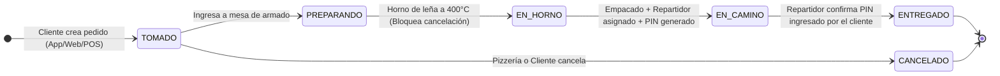

# 🍕 Sr. Pizza® - Sistema Omnicanal B2B & B2C (Showcase & Portafolio de Arquitectura)


Este repositorio contiene el **Showcase Interactivo y la Propuesta de Arquitectura de Software** para **Sr. Pizza®**, una plataforma omnicanal de pedidos de domicilios de alta fidelidad, inspirada en los estándares de clase mundial de sistemas como **Domino's Pizza Tracker**, **Rappi** y **Toast POS**.

---

## 🎯 Propósito del Proyecto

Diseñado para demostrar **buenas prácticas de ingeniería de software empresarial**:
1. **Modelado de Dominio (DDD):** Máquina de estados estricta para el ciclo de vida del pedido (*Tomado ➔ En Preparación ➔ En Horno a 400°C ➔ En Camino con Moto ➔ Entregado con PIN*).
2. **Arquitectura C4 Model:** Documentación formal en niveles de Contexto y Contenedores.
3. **Persistencia Políglota:** Separación de datos transaccionales ACID (PostgreSQL) vs. telemetría GPS efímera de alta frecuencia (Redis Geo).
4. **Experiencia de Usuario (UI/UX):** Sistema de diseño oscuro de lujo (Glassmorphism), micro-animaciones, síntesis de audio para eventos táctiles y mapa interactivo.

---

## 📐 Vistas del Sistema (Omnicanal)

El showcase interactivo permite alternar y probar en vivo las distintas capas de la plataforma:

1. **📱 App Móvil B2C (Cliente Final):**
   - Catálogo de pizzas con personalizador de tamaño, tipo de masa (borde de queso) e ingredientes extra.
   - Pestaña de ofertas activas y cupones de descuento automáticos (`MARTES2X1`, `PIZZA20`).
   - Carrito de compras con cálculo dinámico y desglose de domicilios.
   - **Domino's Live Tracker:** Barra de progreso de 5 estados en tiempo real con PIN de seguridad y telemetría de motorizado.
2. **👨‍🍳 Panel KDS de Cocina & Despacho (B2B):**
   - Control de comandas para maestros pizzeros con cronómetro de horneado y avance de pedidos.
   - Asignación de motorizados y disparo de simulación GPS.
3. **🖥️ Punto de Venta (POS Presencial) & Kiosko:**
   - Interfaz táctil de alta densidad para venta rápida en mostrador.
4. **🌐 Landing Page Comercial:**
   - Diseñada para conversión, posicionamiento SEO local y pedidos rápidos web.

---

## 🚀 Arquitectura y Decisiones Técnicas

### 1. Máquina de Estados Finita (FSM)



### 2. Stack Tecnológico

| Capa | Tecnología | Justificación |
| :--- | :--- | :--- |
| **Frontend Móvil & Web** | **React / React Native** | Código universal multiplataforma (Web, Android e iOS). |
| **Backend Core** | **Node.js (Express / Fastify)** | Event-loop asíncrono no bloqueante para miles de conexiones concurrentes. |
| **Tiempo Real** | **WebSockets (Socket.io) + Redis Pub/Sub** | Latencia < 50ms para el movimiento de la moto en el mapa. |
| **Base de Datos** | **PostgreSQL 16 + PostGIS** | Consistencia transaccional ACID y cálculo geoespacial de cobertura. |
| **Telemetría Efímera** | **Redis Geo** | Almacenamiento en memoria con TTL para coordenadas de motorizados. |
| **Seguridad Financiera** | **Cumplimiento PCI-DSS** | Tokenización de pasarelas (Stripe/MercadoPago), sin guardar datos de tarjetas. |

---

## 💻 Cómo Ejecutar el Showcase Localmente

No requiere instalación de librerías externas ni bases de datos. Es un prototipo 100% interactivo:

1. Clona el repositorio:
   ```bash
   git clone https://github.com/tu-organizacion/sr-pizza-showcase.git
   cd sr-pizza-showcase
   ```
2. Abre `index.html` en cualquier navegador web moderno (Chrome, Edge, Firefox, Safari):
   ```bash
   # En Linux / macOS
   open index.html || xdg-open index.html

   # O usando cualquier servidor local estático:
   npx serve .
   ```

---

## 👨‍💻 Autor

Desarrollado y diseñado por **Nicolás León**  
*Ingeniería de Software & Arquitectura de Soluciones*  
- **GitHub:** [@Nicolas11Leon](https://github.com/Nicolas11Leon)
- **Email:** leonparranicolas@gmail.com
