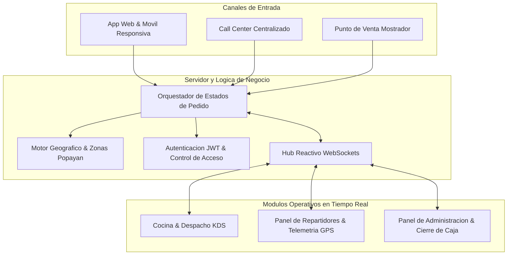
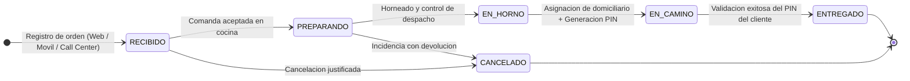

# Sr. Pizza - Plataforma Omnicanal de Domicilios, Telemetria en Tiempo Real y Operaciones B2B/B2C

Plataforma de alta ingenieria de software para la gestion integral de pedidos, telemetria vial calle por calle y control operativo de restaurantes de alta demanda. Inspirada en los estandares de la industria como Domino's Pizza Tracker, Toast POS y Uber Eats, disenada especificamente para el ecosistema urbano y comercial de Popayan, Cauca, Colombia.

---

## 1. Vision y Proposito Tecnico

Sr. Pizza resuelve la desconexion operativa entre los canales digitales de clientes (B2C), los canales de recepcion telefonica (Call Center), las lineas de horneado (Kitchen Display System - KDS), la flota de domicilios motorizados y la direccion administrativa.

### Pilares Fundamentales de Diseno
1. **Consistencia Transaccional y Tiempo Real:** Enlace bidireccional entre eventos de clientes y operadores mediante WebSockets de baja latencia (<50 ms), garantizando sincronizacion instantanea en todas las pantallas.
2. **Modelo de Dominio Estricto (DDD):** Maquina de estados finita que asegura que cada orden transite unicamente por rutas validas, asegurando trazabilidad punta a punta.
3. **Erradicacion Total de Emojis y Sistema de Diseno Editorial:** Identidad visual profesional basada en el sistema Porcelana Calida & Carmesi Artesanal (#FFFFFF / #FAF8F5 / #B20000), con iconografia vectorial y activos multiescala de alta definicion (Retina 1:1).
4. **Seguridad y Garantia Legal:** Cumplimiento normativo estricto de Habeas Data (Ley 1581 de 2012) y Proteccion al Consumidor (Ley 1480 de 2011) con retencion inmutable de auditoria en cada transaccion.

---

## 2. Mapa de Capacidades y Modulos del Sistema



---

## 3. Descripcion Funcional por Capas

### A. Experiencia del Cliente Final (B2C Movil & Web)

1. **Carta Digital & Catalogo Gourmet:**
   - Presentacion de especialidades tradicionales y de la casa (Pizza Payanesa con masa tipo galleta, Carnes Gourmet, Cuatro Quesos, Hawaiana Artesanal, etc.).
   - Modos de visualizacion adaptados a pantallas moviles o de escritorio con alternancia de temas y accesibilidad.
2. **Constructor Dinamico 'Arma 8 Porciones' (Slice Builder):**
   - Interfaz interactiva circular donde el cliente selecciona independientemente el sabor de cada una de las 8 porciones de su pizza extragrande a precio fijo parametrizado.
3. **Motor de Ofertas y Promociones Dinamicas:**
   - Evaluacion en tiempo real de cupones de descuento (por porcentaje, monto fijo o promociones condicionadas como Martes 2x1).
4. **Pasarela de Checkout Omnicanal:**
   - Compatibilidad con multiples metodos de pago:
     - Efectivo contra entrega (con solicitud de cambio para facilitar el vuelto exacto).
     - Datafono inalambrico en puerta.
     - Transferencia electronica bancaria directa / Nequi con carga y previsualizacion de comprobante digital.
5. **Domino's Live Tracker (Telemetria y Ciclo de Vida):**
   - Panel de seguimiento interactivo en tiempo real estructurado en 5 etapas canonicas:
     - Recibido (Call Center / Validacion)
     - Preparando (Mesa de armado en cocina)
     - En Horno (Coccion y control de tiempo de despacho)
     - En Camino (Reparto motorizado con trazado de ruta cartografica)
     - Entregado (Confirmacion mediante PIN de seguridad)
   - Estimador dinamico de tiempo restante (ETA) desglosado por carga de cocina y transito urbano.
   - Validacion de entrega por PIN numerico de 4 digitos que previene entregas erroneas o fraude en via publica.
6. **Buzon de Notificaciones & Historial de Pedidos:**
   - Centro de mensajeria transaccional con control de lectura e historial persistente indexado por linea telefonica para recompra en un clic.

---

### B. Modulo de Call Center Centralizado

1. **Ruteo Inteligente Multisede:**
   - Distribucion balanceada de pedidos hacia las 3 sedes oficiales de Popayan (Torres del Rio, TerraPlaza y El Uvo) segun distancia y capacidad operativa.
2. **Supervision Antifraude y Auditoria de Comprobantes:**
   - Visor de comprobantes de pago de alta resolucion con herramientas de aprobacion o rechazo motivado.
3. **Comunicacion Directa al Cliente:**
   - Boton de discado telefonico en un clic y generador de enlaces de WhatsApp estructurados con plantillas predeterminadas de confirmacion y aclaracion de direccion.

---

### C. Cocina y Despacho (Kitchen Display System - KDS)

1. **Cola de Produccion Priorizada:**
   - Visualizacion de comandas con identificacion de ingredientes, adiciones y configuraciones personalizadas de 8 porciones.
2. **Cronometro de Preparacion y Alertas Visuales:**
   - Control de tiempos por comanda para evitar cuellos de botella en horas pico.
3. **Despacho Inmediato a Flota:**
   - Transicion fluida del estado de la pizza que notifica automaticamente al cliente y a los motorizados en espera.

---

### D. Panel de Flota y Repartidores

1. **Asignacion de Pedidos y Enrutamiento:**
   - Visualizacion de datos del cliente, direccion formal e indicaciones especificas de entrega.
2. **Telemetria de Ruta GPS:**
   - Transmision de ubicacion continua hacia el mapa interactivo del cliente durante el transito.
3. **Cierre de Entrega Protegido:**
   - Formulario de validacion estricta que exige el PIN proporcionado por el cliente para dar por completada la orden.

---

### E. Administracion, Auditoria y Control Financiero

1. **Dashboard de Metricas Operativas (KPIs):**
   - Consolidado de ventas brutas, volumen de pedidos, ticket promedio y distribucion por metodos de pago.
2. **Arqueo y Cierre de Caja de Turno:**
   - Conciliacion automatica entre ventas en efectivo registradas a cada domiciliario vs. pagos electronicos.
   - Exportacion de informes de cierre en formato CSV estructurado con codificacion UTF-8 BOM para compatibilidad con software contable y hojas de calculo.
3. **Gestion de Zonas Tarifarias y Cobertura Urbana:**
   - Matriz de tarifas de transporte calibrada por comunas y sectores de Popayan con bloqueo de cobertura para zonas fuera del perimetro urbano autorizado.
4. **Control de Personal y Seguridad Operativa:**
   - Registro de empleados activos, roles y auditoria de peticiones de veto por incidencias o fraudes reiterados.

---

## 4. Arquitectura de Software y Decisiones Tecnicas

### Maquina de Estados Finita del Pedido



### Stack Tecnologico Implementado

| Capa | Tecnologia | Caracteristicas y Justificacion |
| :--- | :--- | :--- |
| **Frontend de Aplicacion** | **React 19 + Vite 8** | Renderizado rapido, interfaz reactiva SPA y optimizacion de paquetes con Rolldown. |
| **Estilos y Maquetacion** | **TailwindCSS 4** | Sistema de diseno utilitario de alto rendimiento sin sobrecarga de runtime. |
| **Backend de Servicios** | **Node.js (Express)** | Arquitectura modular desacoplada con controladores, servicios y validadores estrictos. |
| **Comunicacion Reactiva** | **Socket.io (WebSockets)** | Canales dedicados por identificador de orden y salas operativas para KDS y repartidores. |
| **Almacenamiento Transaccional** | **PostgreSQL (Supabase)** | Integridad relacional estricta, politicas de seguridad RLS y funciones almacenadas optimizadas. |
| **Cartografia y Geocodificacion** | **Google Maps API + Leaflet** | Localizacion de barrios de Popayan, calculo de distancias viales y trazas de telemetria. |
| **Identidad Visual** | **Pipeline Neural (u2net / Lanczos)** | Iconografia multiescala 1:1 transparente en PNG y WebP con definicion Retina 4K. |

---

## 5. Garantia de Calidad y Suite de Pruebas

La estabilidad de la plataforma esta respaldada por una bateria exhaustiva de pruebas automatizadas de ciclo de vida completo:

- **89 Casos de Uso Validados E2E (100% aprobados):**
  - Verificacion de catalogo y personalizacion de 8 porciones.
  - Estimacion dinamica de transito por zonas de Popayan.
  - Validacion de consentimiento legal de Habeas Data.
  - Flujo integral de orden: Recepcion -> Cocina -> Horno -> Asignacion -> GPS -> Entrega por PIN.
  - Auditoria de rechazo de entregas ante intentos con PIN invalido.
  - Conciliacion contable y exportacion de arqueo.
  - Transmision y recepcion de 17 eventos reactivos en el bus de sockets.

---

## 6. Ejecucion del Entorno Local

### Requisitos Previos
- Node.js 20 o superior
- Administrador de paquetes npm

### Pasos de Puesta en Marcha

1. **Instalacion de Dependencias:**
   ```bash
   npm install
   ```

2. **Ejecucion en Modo Desarrollo (Backend + Frontend):**
   ```bash
   # Opcion recomendada: arranca ambos entornos simultaneamente
   npm run dev

   # O por separado en terminales independientes:
   npm run dev:backend   # Escuchando en http://localhost:4000
   npm run dev:frontend  # Escuchando en http://localhost:5173
   ```

3. **Ejecucion de la Suite de Pruebas:**
   ```bash
   npm test --prefix backend
   ```

4. **Compilacion de Produccion:**
   ```bash
   npm run build
   ```

---

## 7. Creditos y Autoria

- **Plataforma:** Sr. Pizza Popayan
- **Diseno de Arquitectura e Implementacion:** Nicolas Leon
- **Enfoque Tecnico:** Ingenieria de Software, Clean Architecture y Sistemas de Tiempo Real
