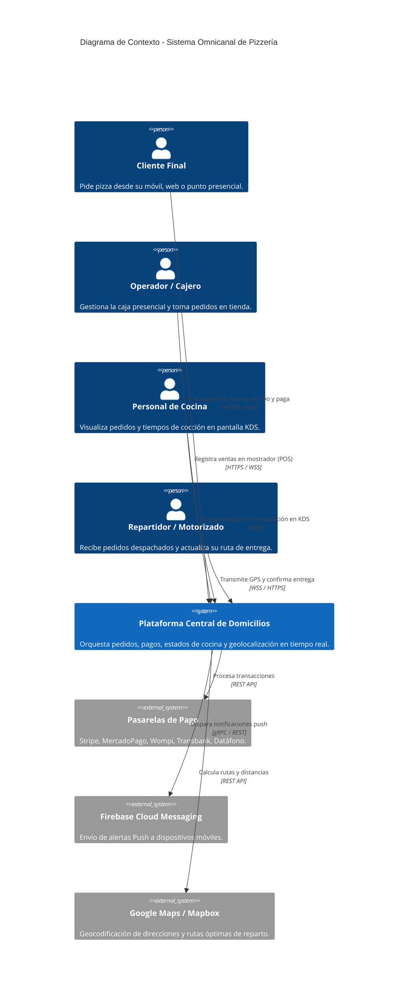
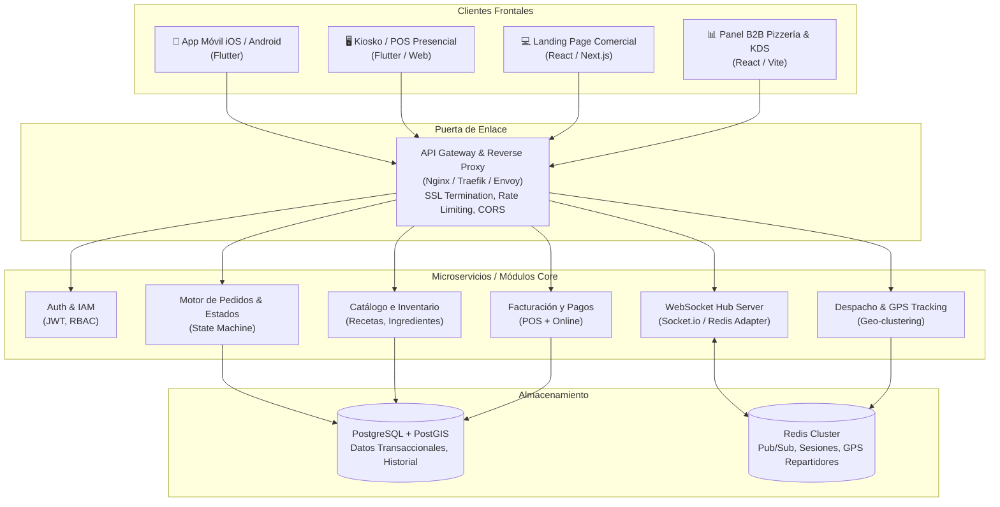
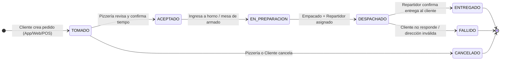
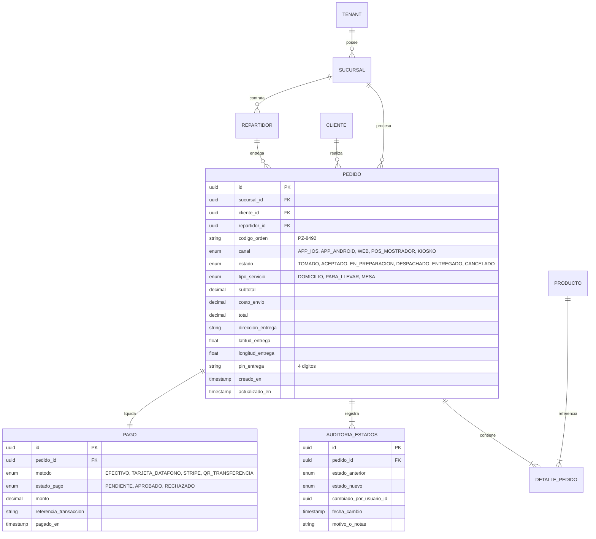

# Planeación Inicial de Arquitectura de Software
## Sistema Multiplataforma de Domicilios y Gestión para Pizzerías (B2B + B2C + POS)

**Versión:** 1.0.0  
**Fecha:** Septiembre 2026  
**Estado:** Propuesta Técnica de Arquitectura y Mockups  

---

## 1. Resumen Ejecutivo y Objetivos

El sistema es una plataforma integral omnicanal diseñada para operar la venta y entrega de pizzas a través de tres frentes sincronizados en tiempo real:

1. **Canal B2C (Clientes Finales):**
   - Aplicaciones móviles nativas para **iOS** (App Store) y **Android** (Google Play Store).
   - **Landing Page y Web App** de pedidos responsiva para posicionamiento SEO y compras rápidas sin descarga obligatoria.
2. **Canal Presencial (Puntos de Pago y Kioskos):**
   - Terminales de punto de venta (POS) y kioskos de autoservicio para pedidos en mostrador y mesa con cobro presencial (efectivo, datáfono, QR).
3. **Canal B2B (Operación de la Pizzería):**
   - Panel de control operativo para administradores, despachadores y cocina (KDS).
   - Gestión estricta del ciclo de vida de los domicilios: **Tomado ➔ Aceptado ➔ En Preparación ➔ Despachado ➔ Entregado**.
   - Asignación de repartidores y tracking de motorizados.

---

## 2. Decisiones Tecnológicas Clave

| Capa / Componente | Tecnología Seleccionada | Justificación Técnica |
| :--- | :--- | :--- |
| **Apps Móviles Clientes (iOS / Android)** | **Flutter (Dart)** | Código único nativo AOT, rendimiento 60/120 FPS, consistencia visual en personalización de pizzas (mitades, ingredientes) y mapas interactivos. |
| **Punto de Venta / Kiosko Táctil** | **Flutter (Desktop / Android POS)** | Mismo motor UI de Flutter desplegado en terminales táctiles (Sunmi, Clover, iPads o pantallas táctiles Linux/Windows). |
| **Landing Page & Menú Web** | **React / Next.js (TypeScript)** | Carga en < 1 segundo, SSR/SSG óptimo para indexación en Google (SEO local *"pizza a domicilio"*), accesibilidad web y meta tags OpenGraph. |
| **Panel B2B Pizzería (Backoffice/KDS)** | **React / Vite (TypeScript)** | Tableros Kanban de alta densidad, drag-and-drop con soporte multi-monitor para cocina y despacho. |
| **Backend Core & APIs** | **Node.js (NestJS / TypeScript) o Go** | Arquitectura modular orientada a eventos. El event-loop asíncrono sostiene miles de conexiones WebSocket simultáneas con baja latencia. |
| **Comunicaciones en Tiempo Real** | **WebSockets (Socket.io / WSS) + Redis Pub/Sub** | Notificaciones instantáneas entre clientes, cocina y repartidores (< 100ms de latencia). |
| **Base de Datos Transaccional** | **PostgreSQL** | Integridad ACID para pedidos, dinero, inventarios y consultas geoespaciales nativas con **PostGIS** (cálculo de radio de cobertura de entrega). |
| **Caché y Coordenadas GPS** | **Redis** | Caché de menús y almacenamiento efímero de alta velocidad para la ubicación en vivo de repartidores (TTL geo-hashing). |
| **Notificaciones Push** | **Firebase Cloud Messaging (FCM) + APNs** | Alertas a la app móvil de clientes y repartidores incluso con el teléfono bloqueado o pantalla apagada. |

---

## 3. Arquitectura del Sistema (C4 Model)

### 3.1. Nivel 1: Diagrama de Contexto del Sistema



### 3.2. Nivel 2: Diagrama de Contenedores



---

## 4. Máquina de Estados del Pedido (Order State Machine)

El núcleo del negocio es la transición controlada de estados del domicilio. Las transiciones no permitidas son rechazadas por el backend con un error `409 Conflict`.



### Reglas de Negocio por Estado:
1. **TOMADO:** Genera alerta auditiva y visual en el panel B2B de la tienda. Se valida el pago o se marca como *Pago Contra Entrega*.
2. **ACEPTADO:** El sistema calcula el tiempo estimado de entrega (ETA: Ej. 35-45 min) y bloquea la cancelación directa por parte del cliente.
3. **EN_PREPARACION:** Aparece en la pantalla de cocina (KDS). El cronómetro inicia en verde; si supera los 15 minutos de horneado, cambia a amarillo y rojo.
4. **DESPACHADO:** Requiere obligatoriamente un repartidor asignado. Se activa la transmisión de coordenadas GPS en tiempo real hacia la app del cliente.
5. **ENTREGADO:** El repartidor ingresa código PIN de 4 dígitos proporcionado por el cliente en su app o firma digitalmente. El ticket se archiva y se computan ingresos.

---

## 5. Clean Architecture "Feature-First" en Flutter (App Móvil y Kiosko)

Para garantizar un código mantenible y desacoplado, el proyecto móvil en Flutter adopta **Feature-First Clean Architecture**:

```
pizza_mobile_kiosk/
├── lib/
│   ├── main.dart
│   ├── core/                        # Utilidades y configuración global
│   │   ├── config/ (routes, env)
│   │   ├── network/ (dio_client, websocket_manager)
│   │   ├── theme/ (colors, typography, dark_theme)
│   │   └── utils/ (formatters, geo_calculator)
│   │
│   └── features/
│       ├── auth/                    # Login clientes, perfiles y direcciones
│       ├── catalog/                 # Menú, combos, personalizador de pizza
│       ├── cart_checkout/           # Carrito, cupones, propinas, pasarela
│       │
│       └── delivery_orders/         # ⭐ MÓDULO ESTRELLA: GESTIÓN DE DOMICILIOS
│           ├── domain/              # 1. Reglas puras de negocio (Zero Flutter)
│           │   ├── entities/
│           │   │   ├── order_entity.dart
│           │   │   ├── order_item_entity.dart
│           │   │   ├── order_status_enum.dart
│           │   │   ├── driver_tracking_entity.dart
│           │   │   └── delivery_address_entity.dart
│           │   ├── repositories/    # Contratos abstractos
│           │   │   ├── i_order_repository.dart
│           │   │   └── i_delivery_tracking_repository.dart
│           │   └── usecases/        # Acciones concretas de negocio
│           │       ├── create_delivery_order.dart
│           │       ├── watch_order_live_status.dart (Stream)
│           │       ├── cancel_order.dart
│           │       └── track_driver_location.dart (Stream)
│           │
│           ├── data/                # 2. Infraestructura y persistencia
│           │   ├── datasources/
│           │   │   ├── order_remote_api.dart (REST Endpoints)
│           │   │   ├── order_socket_client.dart (WebSockets en vivo)
│           │   │   └── order_local_cache.dart (Hive/SQLite offline)
│           │   ├── models/
│           │   │   ├── order_dto.dart (JSON serialization con freezed)
│           │   │   └── driver_location_dto.dart
│           │   └── repositories/
│           │       ├── order_repository_impl.dart
│           │       └── delivery_tracking_repository_impl.dart
│           │
│           └── presentation/        # 3. Interfaz de usuario (Widgets & State)
│               ├── blocs/           # Gestor de estado (BLoC / Riverpod)
│               │   ├── order_lifecycle_bloc.dart
│               │   └── live_tracker_cubit.dart
│               ├── widgets/
│               │   ├── status_stepper_widget.dart (Línea de tiempo animada)
│               │   ├── driver_map_view.dart (Marcador en movimiento)
│               │   ├── pizza_progress_indicator.dart
│               │   └── order_summary_card.dart
│               └── screens/
│                   ├── active_orders_screen.dart
│                   └── order_tracking_screen.dart (Pantalla de seguimiento)
```

---

## 6. Modelo de Datos Relacional (PostgreSQL)



---

## 7. Contratos de API y Eventos WebSocket

### 7.1. REST API: Endpoints Principales
- `POST /api/v1/orders` : Crear nuevo pedido (B2C / POS).
- `GET /api/v1/orders/{id}` : Consultar estado y detalle de pedido.
- `PATCH /api/v1/orders/{id}/status` : Avanzar estado del pedido (Panel B2B / Repartidor).
  - Body: `{ "new_status": "DESPACHADO", "driver_id": "uuid-123", "notes": "En camino" }`
- `POST /api/v1/pos/quick-sale` : Venta ultra-rápida en caja con impresión de comanda.

### 7.2. Eventos WebSocket (Bi-direccionales en tiempo real)
- `server -> client:order_status_updated` : Transmite el nuevo estado a la app del cliente y al panel B2B en < 50ms.
  - Payload: `{ "order_id": "...", "status": "DESPACHADO", "eta_minutes": 20, "driver": { "name": "Carlos M.", "phone": "+57..." } }`
- `client:driver -> server:location_ping` : El repartidor envía sus coordenadas cada 5 segundos:
  - Payload: `{ "driver_id": "...", "order_id": "...", "lat": 4.6534, "lng": -74.0836, "speed_kmh": 28 }`
- `server -> client:driver_moved` : Notifica a la app del cliente para animar suavemente la moto en el mapa.

---

## 8. Seguridad y Cumplimiento
1. **Autenticación Multi-Rol (RBAC):**
   - `SUPERADMIN` : Gestión de franquicias y facturación global.
   - `BRANCH_MANAGER` : Configuración de tienda, precios y arqueo de caja.
   - `KITCHEN_CHEF` : Acceso restringido al KDS de cocina.
   - `DISPATCHER` : Asignación de repartidores y monitoreo de la flota.
   - `DELIVERY_DRIVER` : Acceso exclusivo a la app de repartidores.
   - `CUSTOMER` : Autenticación OTP por SMS o Google/Apple Sign-In.
2. **Seguridad Financiera:** No se almacenan datos de tarjetas de crédito en la base de datos (cumplimiento PCI-DSS mediante tokens de Stripe/MercadoPago).
